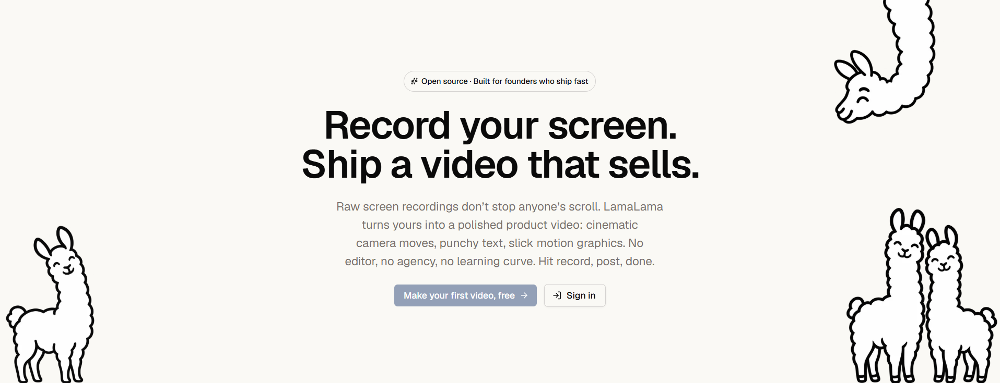

<div align="center">

<a href="https://lamalama.video">
  
</a>

# LamaLama

**Your product, in videos that show it off.**

An open-source, in-browser video editor for product videos. Record or upload your app,
let the AI direct the first cut, polish it in a real editor, then export an MP4 or share a link.

[Website](https://lamalama.video) · [Report a bug](https://github.com/andrebuilds/lamalama/issues/new?template=bug_report.yml) · [Request a feature](https://github.com/andrebuilds/lamalama/issues/new?template=feature_request.yml) · [Contributing](CONTRIBUTING.md) · [Sponsor](https://github.com/sponsors/andrebuilds)

[](https://github.com/andrebuilds/lamalama/actions/workflows/ci.yml)
[](LICENSE)
[](CONTRIBUTING.md)
[](https://github.com/sponsors/andrebuilds)

<br>

<a href="https://lamalama.video">
  
</a>

</div>

---

## Why LamaLama?

Founders need polished product videos all the time: launches, feature announcements, walkthroughs, social clips. Screen recorders capture the raw footage, but turning it into something that looks _directed_ takes an editor's skills and hours in heavyweight desktop tools.

LamaLama does the directing for you, right in the browser.

| Pain                            | LamaLama's answer                                                                                                          |
| ------------------------------- | -------------------------------------------------------------------------------------------------------------------------- |
| Raw screen recordings look flat | A 3D stage with a camera that moves to what matters, plus cuts, speed, transitions, text, motion graphics and lens effects |
| Editing takes skill and time    | AI analyses the footage, finds the key moments and directs a first cut                                                     |
| Desktop editors are heavy       | Everything runs in the browser and saves as you go                                                                         |
| Getting the video out           | Export an MP4 in every shape (16:9, 9:16, 1:1, 4:5) or share a link anyone can watch                                       |

## Features

- **Brand kits** — colours, fonts and logo, drafted automatically from your website.
- **Footage** — record your screen in the browser or upload recordings; analysis finds the key moments.
- **Motion studio** — camera moves, cuts, speed, transitions, text, motion graphics, layouts, lens looks, an AI director and a full-screen preview.
- **Videos** — join clips in order with transitions; versioned saves keep two open tabs from overwriting each other.
- **Export and share** — render MP4s in every aspect ratio, or publish a revocable public share link.
- **Workspaces and teams** — invite teammates by email as Admin, Editor or Viewer, or pick exactly what each member can do.
- **Bring your own AI key** — each workspace adds its own Anthropic API key, encrypted at rest; AI features stay off until there is one.
- **Profile** — a photo, your own llama mascot, and account deletion.
- **Sign in** with Google, GitHub or an email magic link.

### One more thing: Llamageddon

<div align="center">
  
</div>

Press **Make it rain** in the dashboard header. You're welcome.

## Tech stack

| Concern         | Choice                                                                                                          |
| --------------- | --------------------------------------------------------------------------------------------------------------- |
| Framework       | [Next.js 16](https://nextjs.org) (App Router, Server Components, Server Actions), React 19, TypeScript (strict) |
| Database        | PostgreSQL ([Neon](https://neon.tech) recommended) + [Prisma 7](https://www.prisma.io)                          |
| Auth            | [Better Auth](https://www.better-auth.com)                                                                      |
| UI              | [Tailwind CSS 4](https://tailwindcss.com) + [shadcn/ui](https://ui.shadcn.com)                                  |
| Video           | [Remotion](https://www.remotion.dev) for composition, preview and rendering; ffmpeg for processing              |
| AI              | [Vercel AI SDK](https://ai-sdk.dev) (Anthropic by default, provider-agnostic)                                   |
| Background jobs | [pg-boss](https://github.com/timgit/pg-boss) queue in Postgres, run by our own worker                           |
| Storage         | Any S3-compatible bucket (Neon Object Storage by default)                                                       |
| Email           | [Resend](https://resend.com) + React Email                                                                      |
| Testing         | Vitest, Playwright, axe                                                                                         |

## Getting started

### Prerequisites

- **Node.js 22** or newer, and npm
- A **PostgreSQL** database (17 recommended). [Neon](https://neon.tech) is what the project is built on; any Postgres works.
- An **S3-compatible bucket**. Neon Object Storage is the default; for local development a [SeaweedFS](https://github.com/seaweedfs/seaweedfs) or MinIO container works too.
- An API key for **Resend** (email), plus **Google** and **GitHub** OAuth apps for sign-in.
- An **encryption key** for saved API keys: `openssl rand -hex 32`.

AI runs on each workspace's own Anthropic key, added in the app under **Settings → API key**. A key in `.env` is optional, for development and CI only (see `AI_KEY_SOURCE` below).

ffmpeg and ffprobe are installed from npm; Remotion downloads its headless Chrome on first render. Nothing else to install by hand.

### 1. Clone and install

```bash
git clone https://github.com/andrebuilds/lamalama.git
cd lamalama
npm install                  # also generates the Prisma client
cp .env.example .env         # then fill it in, see "Configuration" below
```

### 2. Database and storage

**With Neon (recommended)** — the database and the bucket branch together:

```bash
npm i -g neon && neon login  # Neon CLI, once per machine
neon link --project-id <your-project-id> --no-env-pull -y
neon checkout dev --create   # a dev branch; applies neon.ts (the private `media` bucket)
                             # and writes DATABASE_URL*, AWS_* into .env
npm run storage:cors         # once per branch: checks browsers can upload to the bucket
```

Neon manages bucket CORS itself (open to every origin, files stay private behind signed URLs), so on Neon the command only verifies the rules; on other S3 stores it sets them.

**With your own Postgres and S3** — set `DATABASE_URL`, `DATABASE_URL_UNPOOLED` and the `AWS_*` variables in `.env` yourself, then:

```bash
npm run storage:cors -- --create-bucket
```

### 3. Migrate and run

```bash
npm run db:deploy            # apply migrations
npm run dev                  # app + background worker on http://localhost:3000
```

Footage processing, AI analysis and exports run in the **worker**. `npm run dev` starts it alongside the app; with `npm run dev:web` alone, jobs wait in the queue.

## Configuration

Every variable is listed in [`.env.example`](.env.example) and validated at startup by [`src/shared/config/env-schema.ts`](src/shared/config/env-schema.ts) — a missing or malformed value fails fast with its name.

| Variable                                                                             | Purpose                                                                                                                                    |
| ------------------------------------------------------------------------------------ | ------------------------------------------------------------------------------------------------------------------------------------------ |
| `DATABASE_URL`                                                                       | Pooled Postgres connection for the app                                                                                                     |
| `DATABASE_URL_UNPOOLED`                                                              | Direct connection for migrations and the job worker                                                                                        |
| `BETTER_AUTH_SECRET`                                                                 | At least 32 characters: `openssl rand -base64 32`                                                                                          |
| `BETTER_AUTH_URL`                                                                    | The app's base URL, e.g. `http://localhost:3000`                                                                                           |
| `GOOGLE_CLIENT_ID` / `GOOGLE_CLIENT_SECRET`                                          | Google OAuth                                                                                                                               |
| `GITHUB_CLIENT_ID` / `GITHUB_CLIENT_SECRET`                                          | GitHub OAuth                                                                                                                               |
| `RESEND_API_KEY` / `EMAIL_FROM`                                                      | Magic-link emails, e.g. `LamaLama <hello@yourdomain.com>`                                                                                  |
| `AI_TEXT_PROVIDER` / `AI_TEXT_MODEL`                                                 | AI provider and model id                                                                                                                   |
| `ANTHROPIC_API_KEY` / `AI_KEY_SOURCE`                                                | Optional fallback key for development and CI. Used only with `AI_KEY_SOURCE=env`; the default `byok` counts only keys saved in a workspace |
| `APP_ENCRYPTION_KEY`                                                                 | 64 hex characters that encrypt workspace API keys at rest: `openssl rand -hex 32`. Keep it safe: changing it makes saved keys unreadable   |
| `AI_VISION`                                                                          | `on` (default) or `off` to skip AI descriptions of key moments                                                                             |
| `AWS_ACCESS_KEY_ID` / `AWS_SECRET_ACCESS_KEY` / `AWS_ENDPOINT_URL_S3` / `AWS_REGION` | S3-compatible storage                                                                                                                      |
| `REMOTION_LICENSE_KEY`                                                               | Optional, see [Remotion licence](#remotion-licence)                                                                                        |
| `NEXT_PUBLIC_APP_URL`                                                                | Public URL of the app                                                                                                                      |

App-wide safety limits (clip size and length, daily AI and export budgets, per-user daily caps) live in [`src/shared/config/limits.ts`](src/shared/config/limits.ts).

## Scripts

| Command                               | What it does                                                                                                                                   |
| ------------------------------------- | ---------------------------------------------------------------------------------------------------------------------------------------------- |
| `npm run dev`                         | Dev server and job worker together (worker restarts on change)                                                                                 |
| `npm run dev:web`                     | Dev server only (queued jobs wait until a worker runs)                                                                                         |
| `npm run worker`                      | Start the job worker alone                                                                                                                     |
| `npm run build` / `npm start`         | Production build / serve it                                                                                                                    |
| `npm run lint`                        | ESLint, including slice-boundary rules                                                                                                         |
| `npm run typecheck`                   | TypeScript, no emit                                                                                                                            |
| `npm run format`                      | Prettier                                                                                                                                       |
| `npm test`                            | Vitest unit tests; database tests run when `DATABASE_URL` is set                                                                               |
| `npm run test:watch`                  | Vitest in watch mode                                                                                                                           |
| `npm run test:e2e`                    | Playwright on desktop and 375px mobile (first run: `npx playwright install chromium`)                                                          |
| `npm run db:migrate -- --name <name>` | Create and apply a migration, then regenerate the Prisma client                                                                                |
| `npm run db:deploy`                   | Apply existing migrations                                                                                                                      |
| `npm run db:generate`                 | Regenerate the Prisma client                                                                                                                   |
| `npm run db:studio`                   | Browse the database                                                                                                                            |
| `npm run storage:cors`                | Let browsers upload to the bucket: sets its CORS, or checks it where the store manages CORS (Neon). `-- --create-bucket` for a local S3 server |

## Project structure

LamaLama is organised **by feature (vertical slices)**, not by layer.

```
src/
├── app/        # thin routes only: read params, check auth, render features
├── features/   # one folder per slice (auth, account, workspaces, ai-keys, brand-kits, footage, projects, exports, legal)
│               # other code imports a slice only through its index.ts
├── remotion/   # video compositions, shared by the editor preview and the renderer
├── worker/     # the background job worker (pg-boss + ffmpeg + Remotion)
└── shared/     # feature-agnostic: ui, config, db, ai, storage, jobs, render, styles…
prisma/         # schema.prisma + migrations
tests/e2e/      # Playwright tests
```

The architecture rules are summarised in [CONTRIBUTING.md](CONTRIBUTING.md#architecture-in-one-minute).

Add shadcn components with `npx shadcn@latest add <name>` — they land in `src/shared/ui`.

## Testing

- **Unit and integration** (`npm test`): services, schemas, actions and the real magic-link flow. Tests that need a database run against `DATABASE_URL`.
- **End to end** (`npm run test:e2e`): pages, signed-in flows, accessibility (axe, WCAG 2.2 A/AA) and keyboard use. Signed-in tests create a throwaway user and delete it afterwards; they skip when `DATABASE_URL_UNPOOLED` isn't set.
- **CI** (GitHub Actions): lint, types, formatting, unit and build on every push and pull request, against a fresh `postgres:17` container and a local SeaweedFS S3 server. No external accounts needed. End-to-end tests run locally only.

### Database migrations from a non-interactive shell

`db:migrate` needs an interactive terminal when Prisma shows a warning. Otherwise, generate and apply the SQL yourself:

```bash
dir=prisma/migrations/$(date -u +%Y%m%d%H%M%S)_<name> && mkdir -p "$dir"
npx prisma migrate diff --from-config-datasource --to-schema prisma/schema.prisma --script > "$dir/migration.sql"
# review migration.sql, then:
npx prisma migrate deploy && npx prisma generate
```

## Self-hosting

LamaLama runs as two Node processes:

1. **The web app** — `npm run build && npm start`.
2. **The worker** — `npm run worker`. It runs ffmpeg and headless Chrome for renders, so give it a machine with a few GB of RAM.

Both read the same environment variables, including the same `APP_ENCRYPTION_KEY`. Run `npm run db:deploy` on each release.

The Privacy Policy, Terms and Cookie Policy (`/privacy`, `/terms`, `/cookies`) describe the hosted service at lamalama.video. If you run a public instance, you are the one responsible for it: rewrite them for your own service, starting from the facts in `src/features/legal/lib/legal.ts` (controller, contact email, cookies, providers).

## Remotion licence

LamaLama's own code is MIT-licensed, but video rendering uses [Remotion](https://www.remotion.dev), which has its **own licence**: it is free for individuals and companies of up to 3 people; larger companies need a [company licence](https://www.remotion.dev/license) (set `REMOTION_LICENSE_KEY`). Check which applies to you before deploying LamaLama commercially.

## Contributing

Contributions are welcome — bug reports, ideas, docs and code. Please read [CONTRIBUTING.md](CONTRIBUTING.md) first, and note that this project follows a [Code of Conduct](CODE_OF_CONDUCT.md).

Found a security issue? Please **don't** open a public issue — see [SECURITY.md](SECURITY.md).

## Support the project

LamaLama is free and open source. If it saves you time, you can support its development through [GitHub Sponsors](https://github.com/sponsors/andrebuilds) — every contribution helps keep the llamas running.

## Author

Created and maintained by **Andrea D'Ambrosio** — [@andrebuilds](https://github.com/andrebuilds).

## License

[MIT](LICENSE) © 2026 Andrea D'Ambrosio
